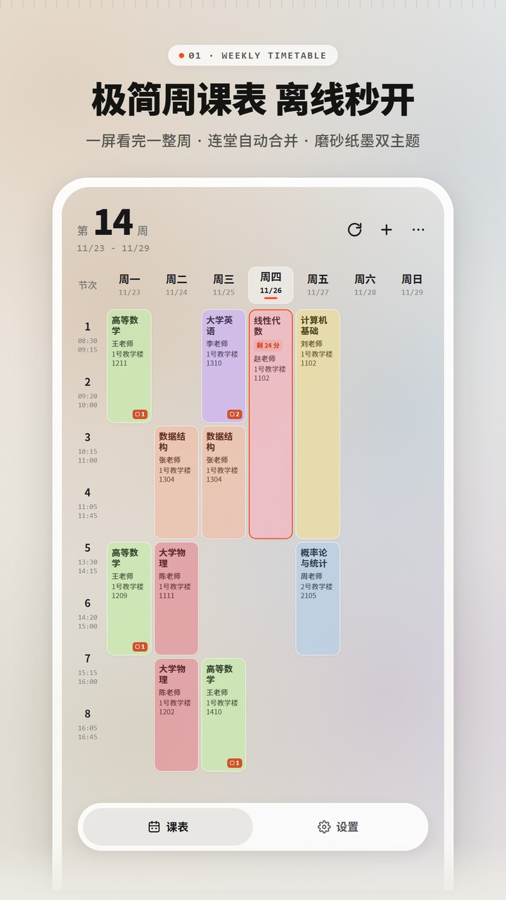
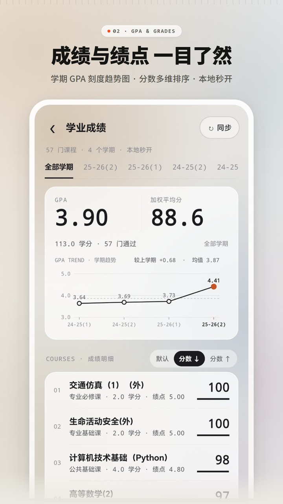
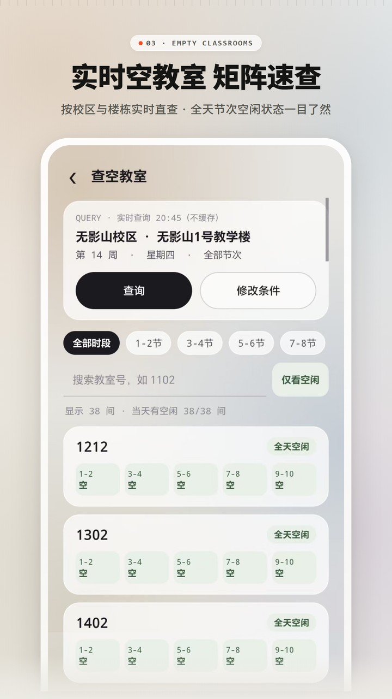
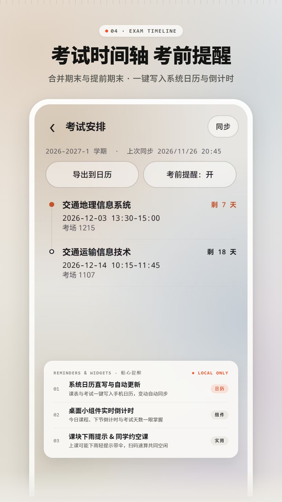
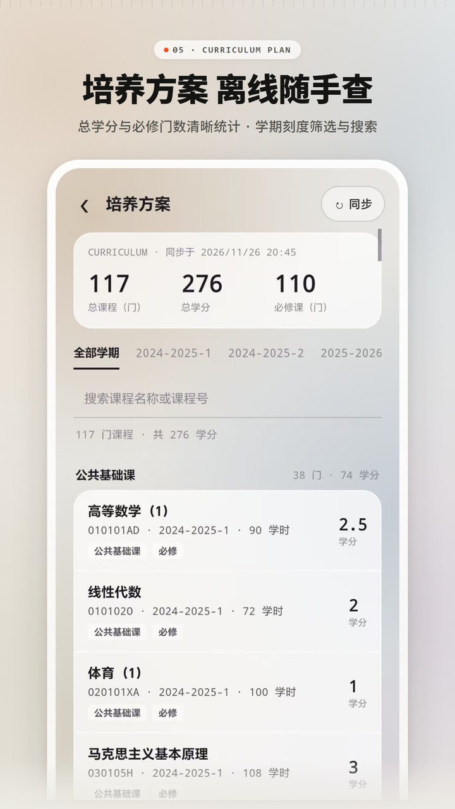

<div align="center">


# 驴驴课表 · 官网静态站点

**`site` 生产分支** · 托管官网页面、隐私声明、更新日志与国内高速直连 APK 分发节点

[](https://lvlv.freeblock.cn)
[](https://edgeone.ai)
[](https://lvlv.freeblock.cn/latest.json)
[](https://github.com/cao-gift/sdjtu-timetable/tree/main)

[在线访问](https://lvlv.freeblock.cn) · [更新清单](https://lvlv.freeblock.cn/latest.json) · [更新日志](https://lvlv.freeblock.cn/changelog.html) · [隐私声明](https://lvlv.freeblock.cn/privacy.html) · [主仓库源码](https://github.com/cao-gift/sdjtu-timetable/tree/main)

</div>

---

## 站点展示素材

> 以下 5 张脱敏实测图由本分支 `showcase/` 目录直接静态托管，同时用于官网首页真机交互预览与主仓库 README 展示。

<table>
  <tr>
    <td align="center" width="20%">
      
      <br /><sub><b>01 · 周课表</b></sub>
    </td>
    <td align="center" width="20%">
      
      <br /><sub><b>02 · 成绩 GPA</b></sub>
    </td>
    <td align="center" width="20%">
      
      <br /><sub><b>03 · 空教室</b></sub>
    </td>
    <td align="center" width="20%">
      
      <br /><sub><b>04 · 考试安排</b></sub>
    </td>
    <td align="center" width="20%">
      
      <br /><sub><b>05 · 培养方案</b></sub>
    </td>
  </tr>
</table>

---

## 目录结构

本分支与应用源码分支（[`main`](https://github.com/cao-gift/sdjtu-timetable/tree/main)）完全隔离，仅存放纯静态站点产物：

| 路径 | 说明 |
| :--- | :--- |
| `index.html` | 官网首页（暖调磨砂玻璃 + Bento 交互卡片），动态拉取 `./latest.json` 展示版本、SHA-256 与直连下载 |
| `changelog.html` | 完整更新日志页，读取 `./changelog.json` 渲染 Markdown 粗体与行内代码 |
| `privacy.html` | 华为应用商店合规隐私政策与隐私权利页（含 `#rights` 锚点） |
| `latest.json` | 客户端应用内检查更新清单（版本号、更新说明、文件大小、SHA-256 与 APK 地址） |
| `changelog.json` | 结构化版本变更数据，由主分支 `scripts/sync-site-changelog.mjs` 生成 |
| `downloads/` | 最新正式版 APK 目录（仅保留当前最新版本，供官网与客户端直连高速下载） |
| `showcase/` | 5 张 9:16 脱敏界面展示图 |
| `icon.png` / `edgeone-logo.png` | 站点图标、Favicon 与 CDN 赞助徽标 |

> [!NOTE]
> 本地 CLI 产生的 `.edgeone/` 与 `.env` 已写入 `.gitignore`，不会提交到仓库。

---

## 自动部署与发版同步

本分支直接绑定至腾讯云 **EdgeOne Pages** 生产环境，推送后自动构建上线：

| 配置项 | 值 |
| :--- | :--- |
| 关联仓库 / 分支 | `cao-gift/sdjtu-timetable` · `site` |
| 构建命令 / 输出目录 | 无（纯静态直出） / `.` |
| 生产域名 | <https://lvlv.freeblock.cn> |

在主仓库根目录（`site/` 已通过 `git worktree` 挂载到本分支）构建新版 APK 后，执行同步并推送：

```bash
# 1. 同步最新 APK、latest.json 与 changelog.json
node scripts/sync-site-release.mjs --apk app/build/outputs/apk/release/app-release.apk --tag vX.Y.Z
node scripts/sync-site-changelog.mjs

# 2. 提交并推送 site 分支，触发 EdgeOne Pages 自动发布
cd site
git add -A
git commit -m "chore(site): release vX.Y.Z"
git push origin site
```

---

## 致谢与反馈

<p>
  本项目 CDN 加速与安全防护由
  <a href="https://edgeone.ai"></a>
  赞助。如有站点访问、下载或内容反馈，欢迎在主仓库提交 <a href="https://github.com/cao-gift/sdjtu-timetable/issues">Issue</a> 或发送邮件至 <code>3514088137@qq.com</code>。
</p>
